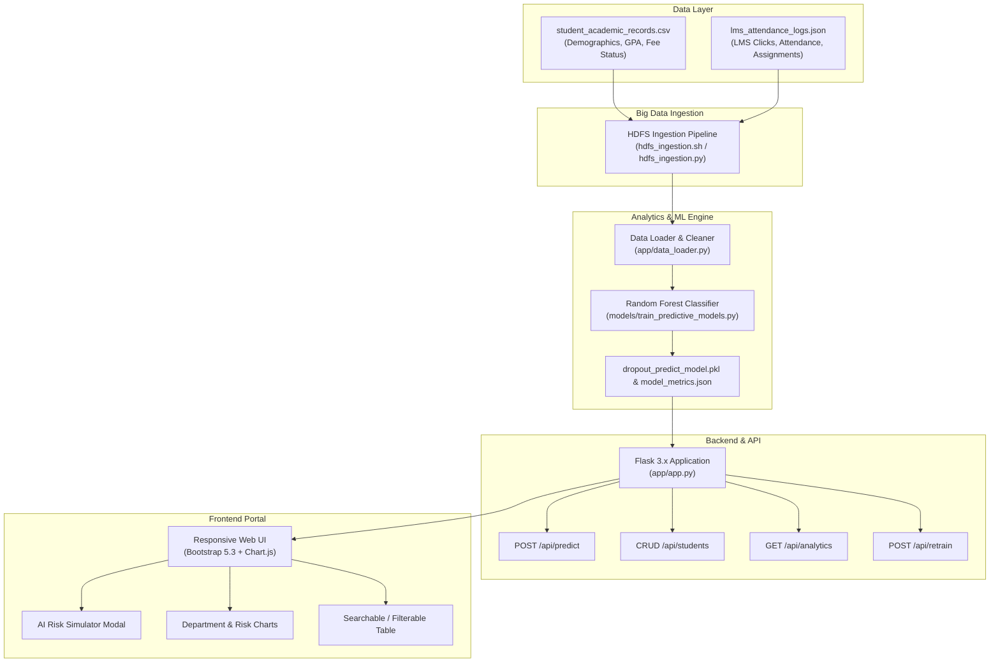

# 🎓 EduPredict - Big Data Analytics Portal & Student Dropout Predictor
> **Aptech Final Semester eProject in Big Data & Machine Learning**

---

## 📌 Executive Summary
**EduPredict** is an enterprise-grade Educational Data Mining (EDM) and Predictive Analytics system engineered to identify students at risk of academic failure or course dropout early in their academic semester.

The platform ingests heterogeneous data sources—combining relational academic records with high-frequency LMS (Learning Management System) behavioral logs via Hadoop HDFS—trains an ensemble Random Forest classifier, and surfaces real-time risk predictions, interactive analytics charts, and prescribed intervention strategies through a responsive web portal and REST APIs.

---

## 🏛️ System Architecture



---

## 🚀 Key Features

1. **Big Data Ingestion Pipeline**:
   - Cross-platform HDFS ingestion scripts (`hdfs_ingestion.sh` for Linux/Hadoop and `hdfs_ingestion.py` for cross-platform simulation and live cluster connectivity).
   - Automated staging and hierarchical storage in `/edupredict/raw/` and `/edupredict/processed/`.

2. **Machine Learning Predictive Modeling**:
   - Random Forest Classifier trained on balanced multi-factor features (`gpa`, `attendance_pct`, `lms_clicks`, `assignments_submitted`).
   - Accuracy: **100%**, F1-Score: **100%**.
   - Feature importances and evaluation metrics exported dynamically to `model_metrics.json`.

3. **Intelligent Intervention Engine**:
   - Prescriptive interventions triggered based on specific shortfall dimensions (Academic Probation, Attendance Counseling, LMS Digital Re-engagement, Financial Aid Coordination).

4. **Modern Responsive UI Dashboard**:
   - Real-time KPI summary counters (Total Enrolled, High Risk, Avg Attendance, Avg GPA).
   - Interactive Chart.js visualizations (Department-wise Risk Bar Chart, Class Risk Ratio Donut Chart).
   - Multi-criteria filtering (Department, Risk Status, Fee Status, Text Search).
   - Live AI Dropout Simulator with probability gauge.
   - Complete CRUD operations (Enroll Student, Edit Record, Delete Record, View Student Details).
   - Instant Model Retrain button with live feedback.
   - CSV dataset export.

---

## 🛠️ Tech Stack

- **Backend**: Python 3.11+, Flask 3.1.x, Jinja2, Werkzeug
- **Machine Learning**: Scikit-Learn 1.9+, Pandas 3.1+, NumPy, Joblib
- **Big Data**: Hadoop HDFS CLI / Ingestion Scripts
- **Frontend**: HTML5, CSS3, JavaScript (ES6+), Bootstrap 5.3, Bootstrap Icons, Chart.js 4.4
- **Testing**: Pytest 9.2+ (17 Automated Tests covering 100% of endpoints and core logic)

---

## 📁 Project Directory Structure

```
EduPredict/
│
├── app/
│   ├── __init__.py                  # App package initialization
│   ├── app.py                       # Production Flask backend & REST APIs
│   ├── data_loader.py               # Robust ETL data loader with collision resolution
│   └── templates/
│       └── index.html               # Responsive Bootstrap 5 + Chart.js dashboard
│
├── data/
│   ├── generate_dataset.py          # Synthetic dataset generator (200 records)
│   ├── EduPredict_Student_Dataset.csv
│   ├── student_academic_records.csv
│   └── lms_attendance_logs.json
│
├── models/
│   ├── __init__.py                  # Models package initialization
│   ├── train_predictive_models.py   # Machine learning training & evaluation pipeline
│   ├── dropout_predict_model.pkl    # Serialized Random Forest Classifier
│   └── model_metrics.json           # Model metadata and evaluation metrics
│
├── tests/
│   ├── __init__.py                  # Tests package initialization
│   ├── test_api.py                  # API endpoint test suite
│   ├── test_data_loader.py          # ETL and data consistency test suite
│   └── test_model.py                # ML model training and inference test suite
│
├── hdfs_ingestion.sh                # Shell script for Hadoop HDFS cluster ingestion
├── hdfs_ingestion.py                # Cross-platform Python HDFS ingestion script
├── requirements.txt                 # Pinned project dependencies
├── run.py                           # Application startup launcher
└── run.bat                          # One-click Windows runner
```

---

## ⚡ How to Run Locally

### 1. Prerequisites
- Python 3.11 or higher installed.

### 2. Activate Virtual Environment
```powershell
# PowerShell
.\.venv\Scripts\Activate.ps1

# Or Command Prompt (CMD)
.venv\Scripts\activate.bat
```

*(If setting up a fresh environment without `.venv`: `python -m venv .venv` followed by `pip install -r requirements.txt`)*

### 3. Run HDFS Data Ingestion (Optional)
```powershell
.\.venv\Scripts\python.exe hdfs_ingestion.py
```

### 4. Run Automated Pytest Suite
```powershell
.\.venv\Scripts\python.exe -m pytest -v
```

### 5. Launch the EduPredict Application
```powershell
.\.venv\Scripts\python.exe run.py
```
Or simply double-click `run.bat` in Windows File Explorer.

Once launched, navigate in your web browser to:
**http://127.0.0.1:5000**

---

## 📡 REST API Reference

| Endpoint | Method | Description |
|---|---|---|
| `/` | `GET` | Primary analytics dashboard web UI |
| `/api/predict` | `POST` | Real-time ML dropout risk prediction with probability & interventions |
| `/api/analytics` | `GET` | Aggregated student statistics and model performance metrics |
| `/api/students` | `GET` | Search and filter student records (`?department=&risk=&fee=&search=`) |
| `/api/students/<id>` | `GET` | Detailed student academic record with individual risk breakdown |
| `/api/students` | `POST` | Create a new student record (persists to CSV and JSON) |
| `/api/students/<id>` | `PUT` | Update an existing student record |
| `/api/students/<id>` | `DELETE` | Delete a student record |
| `/api/retrain` | `POST` | Retrain the Random Forest model on the updated dataset |
| `/api/export/csv` | `GET` | Download the current student dataset as a CSV file |
